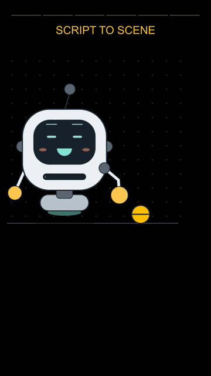

# beatframe

**Escribe un guion. Obtén una animación vertical narrada y sincronizada palabra a palabra.**



▶ [Ver la demo con sonido (MP4, 21 s, en inglés)](docs/demo-voice.mp4) · [English](README.md)

En un editor con línea de tiempo cada animación se ancla a un segundo; si cambias una frase de la narración, todo lo que viene después se descuadra. En beatframe las animaciones se anclan a **palabras** («en *empuja*, la pelota rueda»). La voz se genera (o se aporta) con el tiempo de cada palabra y la escena la espera, así que sigue sincronizada aunque cambie el texto.

```python
self.en("b3", "push", ball.animate.shift(RIGHT), robot.anim(pose="explica"), run_time=0.9)
self.en("b4", "charge", robot.anim(carga=1.0), run_time=1.2)
```

Funciona sobre [Manim](https://www.manim.community/) y está pensado para explicaciones verticales cortas (9:16).

## Qué hace

- **Tiempos anclados a palabras.** `self.en(beat, palabra, *animaciones)` espera la palabra y encaja las animaciones en lo que queda del beat. Si no caben, dice cuánto vas tarde y sugiere una palabra donde sí caben.
- **Subtítulos desde la voz.** Los tiempos por palabra mueven los subtítulos tipo karaoke y la boca del personaje.
- **Revisión automática antes del render.** Una pasada sin dibujar busca, a 15 y a 30 fps:
  - textos que se pisan;
  - textos demasiado pequeños;
  - pantalla saturada;
  - zonas seguras invadidas.

  Un retraso o un solape detiene el render y dice dónde.
- **Hojas de revisión.** Cada render deja hojas con el último fotograma de cada beat y las zonas seguras de las plataformas verticales.
- **Pronunciación (opcional).** Un reconocedor local escucha cada frase generada y marca las palabras que salieron mal.
- **Etapas con caché.** Voz, comprobaciones, render, mezcla y hojas se guardan con la huella de sus entradas. Si una fuente cambia a mitad de la ejecución, no se entrega el resultado.
- **Personajes como estado.** Un personaje es un conjunto de poses y una función de dibujo. `Demo`, el robot de arriba, está hecho solo con primitivas: es la plantilla para los tuyos.

## Empezar

Probado con Python 3.11 en Windows; las pruebas también se ejecutan en Linux con CI. Instala FFmpeg y las dependencias de sistema de [Manim](https://docs.manim.community/en/stable/installation.html). Después:

```sh
python -m venv .venv
# activa el entorno con el comando de tu terminal
python -m pip install -r requirements-publico.txt
python motor/pruebas_motor.py        # ~1 minuto, sin red
python ejemplo/ejecutar.py           # ejemplo sin red: tonos en vez de voz
python demo-voz/ejecutar.py          # la demo narrada de arriba (la voz necesita internet)
```

Cada ejecución escribe en la carpeta del ejemplo:
- `vista-previa.mp4`: 540×960 a 15 fps;
- las hojas de revisión, en `revision/`.

Con `--final` sale a 1080×1920 y 30 fps.

## Tu propia escena

1. **Guion:** copia `demo-voz/guion.json`. Un beat por frase, con los campos `id`, `personaje`, `voz` (una voz de edge-tts), `texto`, `escenario` y `visual`. Indica en `"idioma"` el idioma del guion.
2. **Escena:** copia `demo-voz/escena.py`. Hereda de `EscenaEstudio` y ancla cada acción a una palabra con `self.en(...)`.
3. **Producir:** `python motor/producir.py <carpeta>`. Con `--choques` solo se ejecutan las comprobaciones.

## Límites

- La API y los mensajes están en español. Los alias en inglés son una buena primera contribución.
- La voz usa `edge-tts`, un servicio externo. El ejemplo sin red y las pruebas no lo necesitan.
- Las comprobaciones muestrean la animación: no certifican cada píxel ni el contenido. Mira el resultado.
- Windows es la plataforma probada; macOS no se ha probado. Todavía no está en PyPI.

## Configuración

Sin manifiesto se usan valores neutros, sin voces asignadas ni recetas registradas. `MOTOR_CONFIG=-` desactiva las extensiones; las pruebas y los ejemplos usan ese modo.

Las extensiones ejecutan Python de confianza: carga solo archivos que controles.

Para la pronunciación hay que instalar `requirements-voz.txt` (faster-whisper).

## Contribuir

Lee [CONTRIBUTING.md](CONTRIBUTING.md) y busca los issues **good first issue**. Código de conducta: [CODE_OF_CONDUCT.md](CODE_OF_CONDUCT.md).

## Licencia

MIT: [LICENSE](LICENSE).
