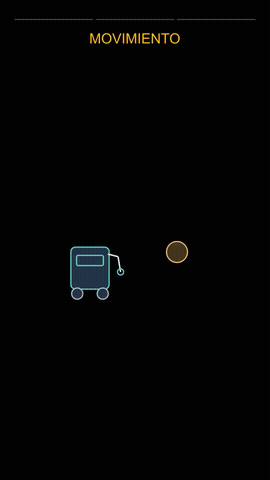

# Herramientas de animación por guion

Construye escenas verticales desde un guion estructurado, marcas por palabra y componentes vectoriales reutilizables.

[English](README.md). La API y los subtítulos del ejemplo están en español.



## Instalación y ejemplo

Entorno probado: Python 3.11 en Windows, con las versiones de `requirements-publico.txt`. Instala FFmpeg y las dependencias de sistema de [Manim](https://docs.manim.community/en/stable/installation.html). Después:

```sh
python -m venv .venv
# Activa el entorno con el comando correspondiente a tu terminal.
python -m pip install -r requirements-publico.txt
python motor/pruebas_motor.py
python ejemplo/ejecutar.py
```

El ejemplo llama a `motor/producir.py`, escribe `ejemplo/vista-previa.mp4` y genera hojas de revisión en `ejemplo/revision/`. Añade `--final` para la resolución completa.

Usa tonos sintetizados localmente y marcas escritas: **no contiene narración ni mide tiempos reales de habla** y no contacta un servicio de voz. Un módulo geométrico mueve un disco, señala y completa un indicador. No incluye imágenes ni archivos de fuentes externos.

## Cómo funciona

1. `guion.json` contiene una lista de beats; cada frase declara `id`, `personaje`, `voz`, `texto`, `escenario` y `visual`.
2. Una producción hablada necesita audio y marcas reales por palabra. La integración opcional con `edge-tts` usa un servicio externo.
3. `escena.py` hereda de `EscenaEstudio` y sincroniza animaciones con `self.en(...)`, `hasta` y `fin_beat`. El personaje inicial está en `personajes.demo`.
4. `python motor/producir.py <carpeta>` revisa entradas, composición, tiempos, render y audio, con caché por etapas y comprobación de estabilidad de las fuentes.

Sin manifiesto se usan valores neutros, sin voces asignadas ni recetas registradas. `MOTOR_CONFIG=-` desactiva extensiones; las pruebas principales y el ejemplo lo usan. El manifiesto opcional declara `{"configuracion":"<directorio>"}` y ese directorio contiene `config.json`. Las extensiones ejecutan Python de confianza: carga solo archivos que controles.

La comprobación de pronunciación local es opcional: `python -m pip install -r requirements-voz.txt` instala `faster-whisper`. La primera carga del modelo puede descargar sus pesos. Las pruebas básicas y el ejemplo no lo necesitan.

## Límites y pruebas

Las comprobaciones de composición muestrean la animación; no certifican cada píxel ni el contenido científico o editorial. El contraste y las zonas orgánicas son estimaciones salvo calibración. Abre las hojas y reproduce el resultado completo. Solo se ha probado Windows para esta distribución.

Ejecuta `python motor/pruebas_motor.py`. El catálogo de regresión visual es opcional y se aporta mediante configuración. Un borrador de escena generado necesita revisión antes de usarse como animación terminada.

## Licencia

MIT: [LICENSE](LICENSE). Cubre el software y documentación incluidos en esta distribución. Las dependencias y servicios externos conservan sus propias licencias y condiciones.
