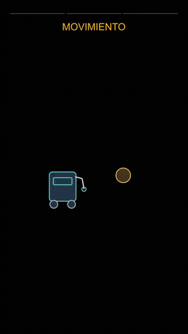

# Scripted animation toolkit

Build vertical animated scenes from a structured script, word cues and reusable vector components.

[Español](README.es.md). The API and example captions currently use Spanish.



## What it does

- Schedule animations at word cues and keep subtitles aligned with the scene clock.
- Render through Manim with a camera that culls invisible objects and caches backgrounds.
- Check text overlap, size, contrast estimates and configurable safe areas.
- Mix optional effects and tracks below narration, and verify audio coverage.
- Resume production stages using input hashes; refuse to confirm outputs if their sources change during a run.
- Load optional local components and validation policies through an external manifest.

## Quick start

The tested environment is Python 3.11 on Windows, with the exact package versions in `requirements-publico.txt`. Install FFmpeg and the system dependencies required by [Manim](https://docs.manim.community/en/stable/installation.html), then:

```sh
python -m venv .venv
# Activate the environment using the command for your shell.
python -m pip install -r requirements-publico.txt
python motor/pruebas_motor.py
python ejemplo/ejecutar.py
```

The last command prepares local audio fixtures and calls `motor/producir.py`. It writes `ejemplo/vista-previa.mp4` and review sheets under `ejemplo/revision/`. For full resolution:

```sh
python ejemplo/ejecutar.py --final
```

The offline example uses quiet synthesized tones and authored word cues, **not spoken narration**. It does not call a speech service. A geometric unit moves a disk, points upward and fills an indicator; its design is built from primitives with no bundled images or font files.

## Create a scene

1. Write `guion.json`: one beat per phrase, with `id`, `personaje`, explicit `voz`, `texto`, `escenario` and `visual`.
2. Supply narration plus measured word timings, or use the optional speech integration to generate them. The speech integration uses `edge-tts`, an external service; it is not an offline guarantee.
3. Subclass `EscenaEstudio` in `escena.py`, set `carpeta` to its folder and import `Demo` from `personajes.demo` as a starting point.
4. Call `self.en(...)` to anchor an animation to a word, or use `hasta` and `fin_beat` for beat boundaries. Run `python motor/producir.py <folder>`.

`ejemplo/escena.py` is a complete small scene. Do not treat generated scene skeletons as finished animations: they deliberately require review.

## Configuration and checks

Without an external manifest the toolkit uses neutral defaults and has no assigned voices or registered scene recipes. `MOTOR_CONFIG=-` explicitly disables extensions; the example and main test command use this mode. Tests simulate speech and require no speech-service credentials.

For extensions, point `MOTOR_CONFIG` at a JSON manifest containing `{"configuracion":"<config-directory>"}`. That directory supplies `config.json`; optional keys include `voces`, `prosodia`, `visual`, `rutas`, `extensiones` and `modulos_compatibles`. Extensions are trusted Python code. Only load files you control.

Automatic composition checks sample the animation; they do not certify every pixel, scientific content or editorial quality. Contrast and organic-platform safe-area profiles are estimates unless calibrated. Inspect the generated review sheets and play the complete result. Only Windows has been tested for this distribution.

Tests: `python motor/pruebas_motor.py`. A visual regression catalog is optional and supplied by configuration; no production-specific catalog is bundled by default.

Local pronunciation recognition is optional: install `python -m pip install -r requirements-voz.txt` to use `pronunciacion.py` with `faster-whisper`. Its first model load can download weights; the basic tests and geometry example do not require it. Speech synthesis and local pronunciation recognition are separate integrations.

## License

MIT — see [LICENSE](LICENSE). The license applies to the software and documentation included in this distribution. Dependencies and external services retain their own licenses and terms.
